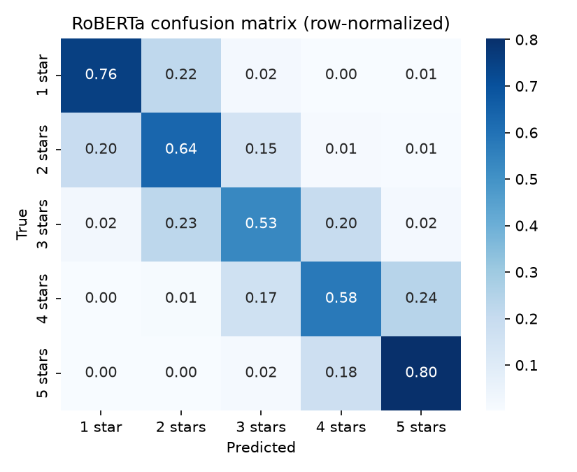

# Predicting Yelp Star Ratings with RoBERTa

**Live dashboard:** https://arthunya.github.io/yelp-star-rating-roberta/

Fine-tuning `roberta-base` to predict the 1 to 5 star rating of a Yelp review, then testing where it fails. The project compares the transformer with a TF-IDF + logistic regression baseline, runs an error analysis on simple linguistic flags, and exports a segment table for a dashboard.



## Results (seed 42, 5,000 test reviews, 1,000 per star)

| Model | Accuracy | Macro-F1 [95% CI] | Mean abs. star error | Within one star |
|---|---|---|---|---|
| TF-IDF + logistic regression | 0.571 | 0.570 [0.557, 0.583] | 0.531 | 0.923 |
| RoBERTa-base | 0.661 | 0.659 [0.646, 0.673] | 0.369 | 0.976 |

The macro-F1 intervals do not overlap. They are 1,000-resample bootstrap intervals and cover test-set sampling only, not training variance. Three training seeds (42, 43, 44) gave RoBERTa accuracy of 0.661, 0.654 and 0.665. Training took about 4 minutes per run on an RTX 5070 Ti laptop GPU.

## What the error analysis shows

- **Most errors are near misses.** 92.9% of the 1,697 RoBERTa errors are off by exactly one star.
- **Middle ratings are hardest.** F1 is 0.564 for 3 stars and 0.587 for 4 stars, against 0.763 for 1 star and 0.774 for 5 stars. The most common confusion is a 4-star review predicted as 5 stars (242 reviews).
- **Contrast words matter.** Reviews containing but, however, although, though or yet are classified correctly 63.3% of the time (n = 3,134), against 70.6% without one (n = 1,866); chi-square = 27.4, p < .001. The gap holds in every length quartile.
- **Caveats.** The flags are keyword rules, not parses. Negation covers 76% of reviews, so that flag is too coarse to interpret. Truncation at 256 tokens overlaps with review length.

In a hand-coded sample of 30 errors (drawn from far misses, adjacent errors and high-confidence errors, so not representative), 11 were one-star boundary cases with clearly positive or negative text and 8 mixed positive and negative points.

## Repository layout

| Path | Contents |
|---|---|
| `notebooks/yelp_roberta_star_prediction.ipynb` | Full pipeline: sampling, baseline, fine-tuning, evaluation, error analysis, SQL layer |
| `results/figures/` | Confusion matrix, accuracy by star, review length distribution |
| `results/dashboard_error_by_segment.csv` | Accuracy and mean star error by segment, ready for Looker Studio or Tableau Public |
| `results/test_predictions_no_text.csv` | Per-review predictions and flags, without review text |
| `results/seed_runs/` | Run records for seeds 42, 43 and 44 (settings, metrics, library versions) |

## How to run

```bash
pip install -r requirements.txt
jupyter notebook notebooks/yelp_roberta_star_prediction.ipynb
```

Run all cells from top to bottom. A CUDA GPU is strongly recommended. Set `DRY_RUN = True` in the first code cell to check the code on synthetic data without downloading anything.

Design choices: stratified sample with seed 42 (4,000 training, 400 validation and 1,000 test reviews per star); validation rows are disjoint from training rows; test rows come only from the official test split; reviews are cut at 256 tokens; 2 epochs at learning rate 2e-5, batch size 16.

## Data and license

The data come from [`Yelp/yelp_review_full`](https://huggingface.co/datasets/Yelp/yelp_review_full), built from the Yelp Dataset Challenge 2015 (Zhang et al., 2015). The dataset card lists the license as "other" and points to Yelp's dataset agreement. **This repository contains no review text.** The notebook downloads the data itself, and files that hold review text are git-ignored.

## Limitations

- Star ratings are a noisy proxy for text, and part of the error is disagreement over where one rating ends and the next begins.
- English-only model. Non-English reviews in the sample were misjudged.
- Subset evaluation (5,000 of 50,000 test reviews).
- Star predictions should not be used to rank businesses or judge individuals without a person reviewing low-confidence cases.

## References

- Liu, Y., et al. (2019). RoBERTa: A robustly optimized BERT pretraining approach. arXiv:1907.11692.
- Wolf, T., et al. (2020). Transformers: State-of-the-art natural language processing. EMNLP 2020 System Demonstrations, 38-45.
- Zhang, X., Zhao, J., & LeCun, Y. (2015). Character-level convolutional networks for text classification. NeurIPS 28, 649-657.
